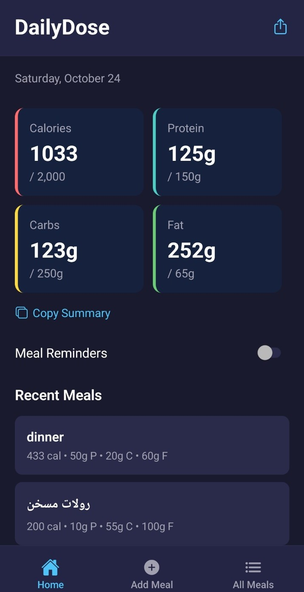
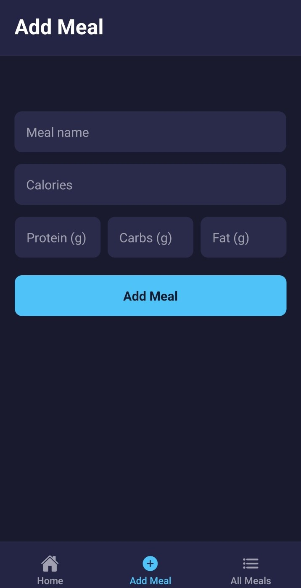
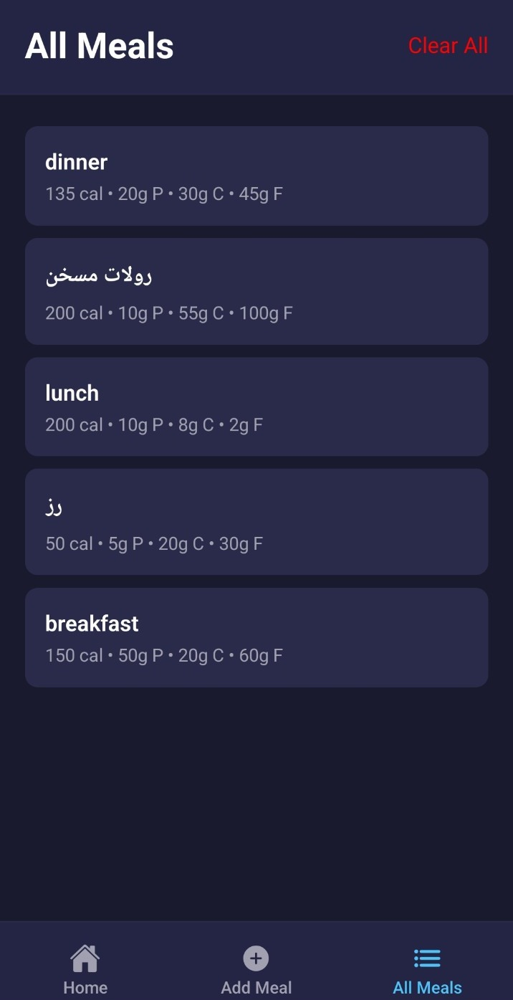

# DailyDose — Calorie & Macro Tracker 🍽️

A simple, dark-themed mobile app for tracking daily calories and macronutrients. **DailyDose** lets you log meals, monitor progress toward your nutrition goals, and review your food entries in one place.

**Built with React Native · Expo SDK 55 · TypeScript**

## 📱 Screenshots

| Daily Dashboard | Add a Meal | All Meals |
| :---: | :---: | :---: |
|  |  |  |

## ✨ Features

- **Daily nutrition dashboard** — view total calories, protein, carbs, and fat alongside daily targets.
- **Quick meal logging** — add a meal name, calories, and macronutrients in grams.
- **Instant updates** — see updated totals and recent meals after adding an entry.
- **Meal history** — browse your logged meals and clear the list when needed.
- **Meal reminders** — turn reminders on or off from the home screen.
- **Copy and share** — copy a daily nutrition summary or access the share action.
- **Clean dark UI** — a simple three-tab layout: Home, Add Meal, and All Meals.

> Nutrition values are entered manually; the app is a tracking tool, not an automatic food-calorie estimator.

## 🛠️ Tech Stack

| Technology | Purpose |
| --- | --- |
| **React Native** | Cross-platform mobile UI |
| **Expo (SDK 55)** | App development and native tooling |
| **TypeScript** | Type-safe development |
| **Expo Router** | File-based app navigation |
| **AsyncStorage** | On-device storage dependency |
| **Expo Notifications** | Notification support |
| **Expo Clipboard** | Clipboard support |

## 🚀 Getting Started

### Prerequisites

- Node.js and npm
- An Android emulator or a physical device with a compatible Expo environment

### Installation

```bash
# Clone the repository
git clone https://github.com/rashedabuodeh/Daily-Calories-App.git

# Enter the project
cd Daily-Calories-App

# Install dependencies
npm install

# Start the Expo development server
npx expo start
```

Follow the terminal instructions to open the app on a device or emulator. To run an Android native development build using a configured Android environment:

```bash
npm run android
```

## 📖 How to Use

1. **Home:** Check your daily calorie and macro totals against your targets.
2. **Add Meal:** Enter the meal name, calories, protein, carbs, and fat, then tap **Add Meal**.
3. **All Meals:** Review logged entries or use **Clear All** to clear them.
4. **Home tools:** Copy your daily summary or toggle meal reminders.

## 👨‍💻 Author

Developed by [rashedabuodeh](https://github.com/rashedabuodeh).
